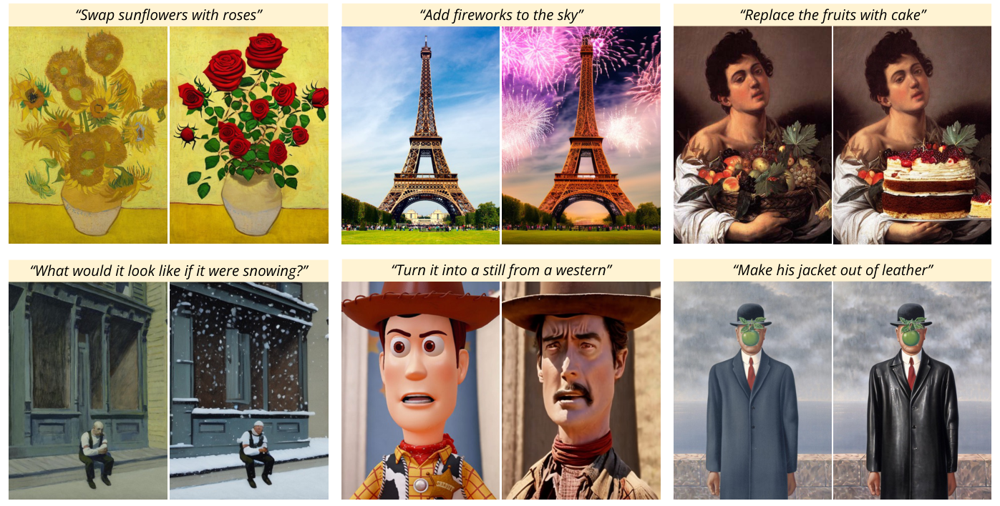
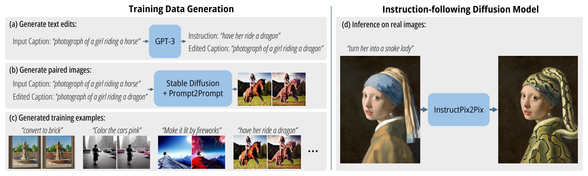
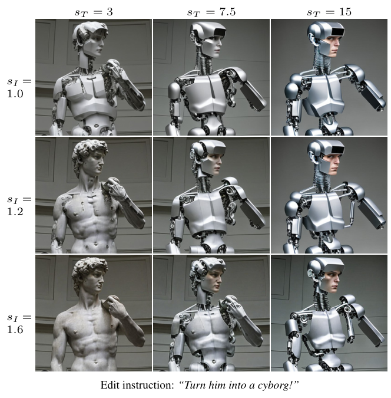
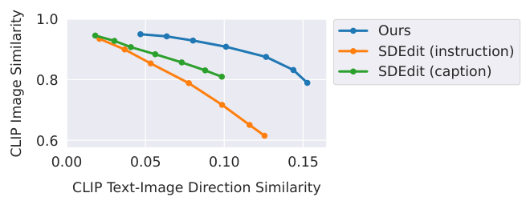
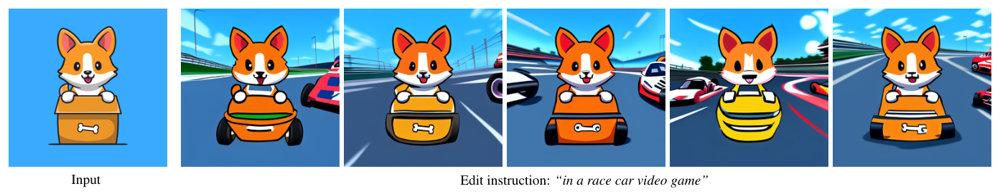
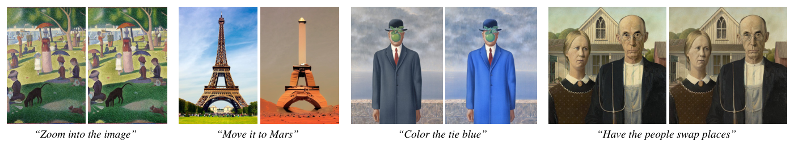

# A2.1 — Đề tài, paper, dữ liệu và kế hoạch pipeline: chỉnh sửa ảnh theo chỉ dẫn với InstructPix2Pix

- Môn học: CO5085 — Học sâu và ứng dụng trong thị giác máy tính, HK261.
- Giảng viên: Lê Thành Sách, Nguyễn Quốc Minh.
- Thành viên: Nguyễn Xuân Trường (2570526), Trần Lê Hoàng Long (2570443).

## 1. Tổng quan

Bài toán là chỉnh sửa ảnh theo chỉ dẫn: đầu vào gồm một ảnh và một câu lệnh tiếng Anh (ví dụ "make it snowy", "add a dragon"); đầu ra là ảnh đã được sửa theo lệnh, đồng thời giữ nguyên những phần lệnh không nhắc tới. Khác với text-to-image thông thường, mô hình không vẽ lại từ đầu mà phải cân bằng giữa hai yêu cầu ngược nhau: thay đổi đủ để làm đúng lệnh, nhưng không thay đổi quá mức cần thiết.



*Hình 1. Ví dụ đầu vào là ảnh và câu lệnh, đầu ra là ảnh đã sửa (nguồn: Brooks và cộng sự, 2023, Hình 1).*

Nhóm chọn InstructPix2Pix vì paper giải quyết bài toán này theo cách gọn và có thể kiểm chứng trong phạm vi một học phần. Mô hình chỉ cần một lần forward qua diffusion, không cần mô tả ảnh gốc hay mask, và checkpoint của tác giả được công bố công khai. Phần thực nghiệm của nhóm không tái tạo toàn bộ paper (tạo 450 nghìn cặp dữ liệu và train trên nhiều GPU), mà xoay quanh một câu hỏi thực tế hơn: **lấy checkpoint đã có rồi fine-tune trên một tập nhỏ thì được gì và mất gì?**

Câu hỏi cần trả lời:

1. Fine-tune U-Net của InstructPix2Pix trên 800 cặp ảnh có cải thiện chất lượng chỉnh sửa so với checkpoint pretrained không, khi đo trên cùng split, seed và thông số suy luận?
2. Các proxy tự động so với ảnh tham chiếu (CLIP, sai số pixel) có phản ánh đúng chất lượng chỉnh sửa không? Khi nào ảnh hợp lệ mà điểm vẫn thấp?
3. Chi phí của fine-tune (thời gian, bộ nhớ, dung lượng checkpoint) có tương xứng với mức thay đổi về chất lượng không?

| Mục | Lựa chọn |
|---|---|
| Paper | Brooks, Holynski, Efros. *InstructPix2Pix: Learning to Follow Image Editing Instructions*. CVPR 2023 |
| Checkpoint khởi đầu | `timbrooks/instruct-pix2pix` (Hugging Face) |
| Dữ liệu | `fusing/instructpix2pix-1000-samples`, 1.000 cặp |
| Biến thể so sánh | Pretrained (không train) và fine-tune U-Net |
| Phần cứng | Google Colab, GPU A100 |

## 2. Paper và phương pháp

**Ý tưởng chính.** Khi các tác giả bắt đầu nghiên cứu, trở ngại lớn nhất của họ là thiếu dữ liệu: gần như chưa có tập lớn nào gồm ảnh trước, câu lệnh và ảnh sau do con người tạo, nên không thể train một mô hình chỉnh sửa theo chỉ dẫn theo cách có giám sát thông thường. Tác giả giải quyết bằng cách *tạo dữ liệu tổng hợp* từ hai mô hình lớn có sẵn:

1. Một mô hình ngôn ngữ (GPT-3 được fine-tune trên vài trăm ví dụ viết tay) nhận caption của ảnh và sinh ra một câu lệnh sửa cùng caption mới sau khi sửa.
2. Stable Diffusion kết hợp Prompt-to-Prompt sinh cặp ảnh từ hai caption đó. Prompt-to-Prompt giữ chung bản đồ cross-attention, nhờ vậy hai ảnh giống nhau ở mọi chỗ trừ phần được sửa.
3. Các cặp được lọc bằng độ tương đồng CLIP, kết quả là khoảng 450 nghìn mẫu.

Đây là cách tác giả xây dựng tập train cho checkpoint pretrained. Nhóm không tự sinh thêm dữ liệu: tập 1.000 mẫu dùng trong bài (mục 3) là một phần nhỏ của chính bộ dữ liệu tổng hợp này, đã được tác giả tạo sẵn và công bố.



*Hình 2. Bên trái: quy trình tác giả tạo dữ liệu, gồm (a) GPT-3 sinh câu lệnh và caption sau khi sửa, (b) Stable Diffusion kết hợp Prompt-to-Prompt sinh cặp ảnh, (c) các mẫu train thu được. Bên phải: (d) mô hình đã train nhận ảnh thật và câu lệnh, sửa ảnh trong một lần chạy (nguồn: Brooks và cộng sự, 2023, Hình 2).*

**Mô hình.** InstructPix2Pix là latent diffusion khởi tạo từ Stable Diffusion. VAE nén ảnh về latent; U-Net học dự đoán nhiễu đã thêm vào latent của ảnh đích. Ảnh nguồn cũng được mã hóa bằng VAE rồi ghép theo kênh với latent nhiễu, nên lớp vào của U-Net có 8 kênh thay vì 4 (các trọng số của 4 kênh mới được khởi tạo bằng 0). Câu lệnh đi qua text encoder CLIP và vào U-Net qua cross-attention. Hàm mất mát là MSE giữa nhiễu dự đoán và nhiễu thật, giống Stable Diffusion.

**Hai thang guidance.** Khi train, điều kiện ảnh và điều kiện văn bản đôi khi bị bỏ đi một cách ngẫu nhiên (conditioning dropout). Nhờ đó lúc suy luận có thể dùng classifier-free guidance với hai hệ số riêng: *image guidance* (càng cao càng giữ giống ảnh gốc) và *text guidance* (càng cao càng bám lệnh). Đây là núm điều chỉnh trực tiếp cho sự đánh đổi đã nói ở mục 1.



*Hình 3. Cùng lệnh "Turn him into a cyborg!": tăng text guidance s_T (sang phải) thì thay đổi càng mạnh, tăng image guidance s_I (xuống dưới) thì ảnh càng giữ giống tượng gốc (nguồn: Brooks và cộng sự, 2023, Hình 4).*

**Đánh giá trong paper.** Paper so sánh định tính với SDEdit và Text2Live. Về định lượng, paper vẽ đường đánh đổi giữa hai đại lượng CLIP: độ giống ảnh vào (ảnh có còn là ảnh cũ không) và độ tương đồng theo hướng (thay đổi giữa hai ảnh có cùng hướng với thay đổi giữa hai caption không).



*Hình 4. Trục ngang: độ tương đồng theo hướng (bám lệnh); trục dọc: độ giống ảnh vào (giữ nội dung). Mỗi điểm là một giá trị image guidance; đường càng nằm phía trên bên phải càng tốt. InstructPix2Pix ("Ours") vượt SDEdit ở mọi mức (nguồn: Brooks và cộng sự, 2023, Hình 8).*

**Hạn chế mà paper tự nêu và nhóm quan tâm.** Chất lượng phụ thuộc dữ liệu tổng hợp; mô hình yếu với lệnh về số lượng, vị trí và thay đổi góc nhìn; một lệnh có thể có nhiều kết quả hợp lệ. Điểm cuối cùng ảnh hưởng trực tiếp tới cách nhóm đánh giá (mục 7).



*Hình 5. Cùng một ảnh và lệnh "in a race car video game", chỉ đổi nhiễu khởi đầu đã cho ra nhiều kết quả khác nhau và đều hợp lệ. Vì vậy so với một ảnh đích duy nhất không đủ để chấm đúng hay sai (nguồn: Brooks và cộng sự, 2023, Hình 12).*



*Hình 6. Các lỗi điển hình: không đổi được góc nhìn ("Zoom into the image"), thay đổi quá mức ("Move it to Mars"), sửa nhầm đối tượng ("Color the tie blue" làm đổi màu cả áo), không hoán đổi được vị trí ("Have the people swap places") (nguồn: Brooks và cộng sự, 2023, Hình 13).*

## 3. Dữ liệu

| Thuộc tính | Giá trị |
|---|---|
| Nguồn | `fusing/instructpix2pix-1000-samples` trên Hugging Face, trích từ dữ liệu tổng hợp của paper |
| Số mẫu | 1.000 bộ (`input_image`, `edit_prompt`, `edited_image`) |
| Ngôn ngữ lệnh | Tiếng Anh |
| Loại lệnh | Đa dạng: đổi phong cách, thêm hoặc thay vật, đổi bối cảnh, thời tiết, chất liệu |

**Lý do chọn.** Tập nhỏ vừa với ngân sách Colab, tải nhanh, đúng định dạng mà script train của Diffusers dùng, và cùng phân phối với dữ liệu gốc của paper. Nhờ vậy nhóm tập trung được vào câu hỏi fine-tune, thay vì tốn thời gian xây dựng dữ liệu.

**Hạn chế cần thừa nhận.** Dữ liệu này rất có thể nằm trong tập đã dùng để train checkpoint pretrained. Vì vậy so sánh trên split nội bộ cho biết fine-tune làm thay đổi mô hình thế nào trên chính phân phối đó, **không** đo khả năng tổng quát hóa sang ảnh mới. Ảnh đích cũng do máy sinh, nên chỉ là một trong nhiều đáp án hợp lệ.

### 3.1 Chia tập

Một ảnh nguồn có thể đi kèm nhiều câu lệnh khác nhau. Nếu chia ngẫu nhiên theo từng mẫu, cùng một ảnh có thể vừa nằm trong train vừa nằm trong test. Vì thế nhóm băm SHA-256 kích thước và pixel RGB của ảnh nguồn, gom các mẫu trùng ảnh thành một nhóm, rồi chia theo nhóm với seed 42, tỉ lệ khoảng 80/10/10.

| Split | Số mẫu | Dùng để |
|---|---:|---|
| Train | 800 | Fine-tune |
| Validation | 100 | Chọn checkpoint và cấu hình |
| Test | 100 | Đánh giá cuối, chỉ chạy sau khi đã chốt lựa chọn |

Chỉ số và hash của từng split được lưu trong `split_manifest.json` để tái lập và để kiểm tra khi resume. Cách băm này chỉ bắt được ảnh trùng chính xác, không bắt được ảnh gần giống.

### 3.2 Tiền xử lý

Ảnh nguồn và ảnh đích được ghép thành một tensor trước khi biến đổi, nên luôn chịu đúng cùng một phép resize về 256×256 và center crop, và vẫn khớp từng pixel. Lúc đánh giá, ảnh cũng được đưa về 256×256 trước khi vào pipeline; nếu tập có ảnh không vuông, cần dùng cùng một cách resize ở train và ở đánh giá để mô hình không thấy hai phân phối khác nhau.

Nhóm **không** dùng lật ngang ngẫu nhiên, vì lệnh có thể nhắc tới trái hoặc phải, lật ảnh sẽ làm cặp dữ liệu sai nghĩa. Cũng không dùng augmentation nào khác: mục tiêu là đo tác động của fine-tune trên đúng phân phối dữ liệu của paper.

### 3.3 Khám phá dữ liệu

Trước khi train, nhóm phân loại lệnh theo nhóm (phong cách, thêm vật, thay vật, bối cảnh, thời tiết…), độ dài lệnh, và một số cặp mà ảnh đích thay đổi quá nhiều so với lệnh. Kết quả dùng để đọc kết quả đánh giá theo từng loại lệnh.

## 4. Pipeline

```
ảnh nguồn ──VAE encoder──► latent nguồn ─┐
                                         ├─ concat (8 kênh) ──► U-Net ──► nhiễu dự đoán
latent đích + nhiễu (timestep t) ────────┘        ▲
câu lệnh ──CLIP text encoder──────────────────────┘ (cross-attention)
```

- **Train:** chỉ U-Net được cập nhật; VAE và text encoder đóng băng. Giữ nguyên lớp vào 8 kênh đã học của checkpoint pretrained, không khởi tạo lại. Script chỉ đưa split train vào vòng tối ưu; validation và test không đi qua dataloader của train.
- **Suy luận:** `StableDiffusionInstructPix2PixPipeline` của Diffusers với hai hệ số guidance; khi đánh giá thì thay U-Net bằng bản fine-tune.
- **Code:** script train lấy từ ví dụ `train_instruct_pix2pix.py` của Diffusers v0.35.1 (giấy phép Apache-2.0), sửa để giữ U-Net 8 kênh và đọc dữ liệu đã chia sẵn bằng `save_to_disk`. Phần chuẩn bị dữ liệu (`prepare_data.py`) và đánh giá (`compare.py`) do nhóm viết.

## 5. Ma trận thí nghiệm

| ID | Biến thể | Train | Mục đích |
|---|---|---|---|
| P0 | Pretrained | Không | Baseline |
| F1 | Fine-tune pilot | 100 optimizer steps | Kiểm tra pipeline end-to-end, đo tốc độ và bộ nhớ trước khi chạy dài |
| F2 | Fine-tune chính | 2.000 optimizer steps (resume từ F1) | Biến thể so sánh chính |
| (tuỳ chọn) | Fine-tune LR 5e-6, hoặc 512×512 | Theo ngân sách đo được ở F1 | Chỉ chạy nếu còn compute, chọn bằng validation |

Ngân sách khởi đầu là 2.000 steps và sẽ được điều chỉnh theo tốc độ đo ở pilot. Với effective batch 16 và 800 ảnh, mức này tương đương khoảng 40 lượt qua tập train. Con số đủ lớn để thấy tác động của fine-tune, nhưng cũng có nguy cơ overfit trên tập nhỏ; đây là một điểm cần quan sát.

Vì nguy cơ overfit, F2 không được đánh giá chỉ ở bước cuối. Trong lúc train, nhóm lưu bản U-Net ở các mốc 100, 500, 1.000, 1.500 và 2.000 steps để so trên validation (mục 7.1). Nhờ vậy F2 thực chất là một đường cong theo số steps, và câu hỏi "train bao lâu là vừa" được trả lời bằng dữ liệu chứ không bằng phỏng đoán.

## 6. Siêu tham số

| Tham số | Giá trị | Lý do |
|---|---|---|
| Độ phân giải | 256×256 | Đúng độ phân giải train của paper; vừa bộ nhớ và thời gian Colab |
| Batch / gradient accumulation | 4 / 4 (effective 16) | Batch nhỏ cho vừa VRAM, accumulation để gradient ổn định hơn |
| Optimizer | AdamW, weight decay 0,01 | Mặc định của script Diffusers |
| Learning rate | 1e-5, hằng số, không warmup | LR nhỏ để không phá trọng số pretrained trên tập 800 ảnh |
| EMA | Không dùng | Với 2.000 steps, EMA gần như chỉ làm chậm thay đổi; bỏ để đọc thẳng tác động của fine-tune |
| Conditioning dropout | 0,05 | Giữ khả năng dùng hai thang guidance như paper (paper dùng cùng tỉ lệ 5%) |
| Precision | bf16, gradient checkpointing | Giảm bộ nhớ và tăng tốc trên A100 |
| Seed train | 42 | |
| Checkpoint đầy đủ | Mỗi 100 steps, giữ 2 bản gần nhất | Để resume khi Colab ngắt; mỗi bản gồm cả trạng thái optimizer nên rất nặng |
| Bản U-Net để đánh giá | Ở các mốc 100, 500, 1.000, 1.500, 2.000 steps | Chỉ trọng số U-Net (bf16), dùng để chọn số steps trên validation |

**Thông số suy luận khi đánh giá** (cố định cho mọi biến thể): 20 bước khử nhiễu, text guidance 7,5, image guidance 1,5, seed 123 + chỉ số ảnh. Như vậy hai biến thể nhận cùng nhiễu khởi đầu cho cùng một ảnh, nên mọi khác biệt chỉ đến từ U-Net.

## 7. Đánh giá

### 7.1 Chọn checkpoint và dùng tập test

Checkpoint được chọn bằng validation, trong số các bản U-Net ở các mốc steps (mục 5). Để giới hạn chi phí suy luận, mỗi mốc được sàng lọc nhanh trên **20 ảnh validation cố định**; hai mốc tốt nhất cùng P0 được chấm lại trên đủ 100 ảnh validation trước khi chốt. Nếu không mốc nào tốt hơn P0 trên validation, nhóm vẫn chạy test cho mốc tốt nhất để có số liệu so sánh, nhưng kết luận sẽ là fine-tune không mang lại cải thiện. Tập test 100 ảnh chỉ chạy một lần cho P0 và checkpoint đã chọn. Mọi phân tích sau khi xem test được ghi rõ là phân tích hậu kiểm, không dùng để chọn lại cấu hình.

### 7.2 Metric tự động

| Metric | Đo gì | Lưu ý |
|---|---|---|
| CLIP image-target cosine ↑ | Độ giống về ngữ nghĩa giữa ảnh sinh và ảnh đích tham chiếu | Proxy; ảnh hợp lệ có thể khác ảnh đích |
| Paired pixel MAE ↓ | Sai số pixel trung bình (chia 255) so với ảnh đích | Nhạy với thay đổi bố cục, màu |
| Thời gian suy luận | Giây/ảnh, có đồng bộ CUDA | Chỉ tính lần gọi pipeline |
| Safety flagged | Số ảnh bị safety checker của pipeline đánh dấu | Ảnh bị đánh dấu thường bị thay bằng ảnh đen |

Hai metric đầu đo độ gần với **một** đáp án tham chiếu, không đo trực tiếp việc làm đúng lệnh. Vì vậy nhóm tính thêm hai đại lượng theo tinh thần của paper (Hình 4):

| Metric | Công thức (E là embedding ảnh CLIP) | Đo gì |
|---|---|---|
| Độ giống ảnh vào ↑ | cos(E(output), E(input)) | Ảnh sau khi sửa có còn là ảnh cũ không (trục dọc của Hình 4) |
| Độ đồng hướng với tham chiếu ↑ | cos(E(output) − E(input), E(target) − E(input)) | Thay đổi mô hình tạo ra có cùng hướng với thay đổi trong ảnh đích không |

Paper tính độ tương đồng theo hướng bằng cặp caption trước và sau khi sửa (hướng trong không gian văn bản). Tập 1.000 mẫu chỉ có câu lệnh, không có hai caption này, nên nhóm thay hướng văn bản bằng hướng ảnh từ input tới ảnh đích. Đại lượng thứ hai vì vậy vẫn phụ thuộc ảnh tham chiếu, nhưng nó chỉ so *hướng* thay đổi chứ không đòi output giống hệt ảnh đích, nên ít bị phạt hơn khi mô hình sửa đúng lệnh theo một cách khác. Vẽ hai đại lượng này lên cùng một hình, theo nhiều mức image guidance, cho ra đường đánh đổi tương tự Hình 4 cho P0 và bản fine-tune.

Nhóm không dùng FID, vì với 100 ảnh thì FID không ổn định.

### 7.3 So sánh theo cặp

Vì hai biến thể chạy trên cùng ảnh, cùng lệnh và cùng seed, nhóm phân tích theo cặp thay vì chỉ so hai giá trị trung bình:

- Đếm số ảnh mà fine-tune tăng hoặc giảm từng metric.
- Khoảng tin cậy 95% cho chênh lệch trung bình bằng bootstrap theo cặp (10.000 lần lặp, seed 42). Khoảng chứa 0 thì không kết luận có cải thiện.
- **Safety checker:** giữ mọi ảnh trong bảng chính, không loại sau khi xem kết quả. Thêm một phân tích độ nhạy trên các ảnh không bị đánh dấu ở cả hai biến thể, vì một ảnh đen có thể kéo lệch cả trung bình.

### 7.4 Đánh giá định tính và đánh giá người

- Chọn trước một số ví dụ minh họa gồm cả trường hợp fine-tune tốt hơn lẫn kém hơn, hiển thị dạng input | ảnh đích | output.
- Chấm người theo thang 1–5 cho ba tiêu chí: làm đúng lệnh, giữ nội dung không cần sửa, chất lượng và artefact. Người chấm không biết ảnh thuộc biến thể nào; chấm trên một tập con test cố định chọn trước.

## 8. Phần cứng và tái lập

- Google Colab, GPU A100. Dữ liệu và cache đọc trên ổ cục bộ của Colab; checkpoint, log và kết quả đánh giá lưu trên Drive.
- Resume bằng cùng `RUN_ID` và cấu hình; manifest dữ liệu được kiểm tra khi resume. Resume không đảm bảo giống từng bit với một lần chạy liên tục.
- Phụ thuộc ghim trong `instructpix2pix/requirements.txt`; dùng PyTorch có sẵn trên Colab.
- Ước tính mỗi checkpoint đầy đủ khoảng 10 GB (U-Net khoảng 860M tham số ở fp32 là 3,4 GB, trạng thái AdamW gấp đôi), nên chỉ giữ hai bản gần nhất. Bản U-Net ở các mốc đánh giá chỉ khoảng 1,7 GB mỗi bản (bf16, không có optimizer), năm mốc tổng khoảng 9 GB. Không commit checkpoint vào Git; các file kết quả nhỏ (summary, CSV, ảnh minh họa) đặt trong `report_assets/`.

## 9. Các bước thực hiện

1. Chuẩn bị dữ liệu: tải, kiểm tra schema, chia theo nhóm ảnh nguồn, lưu manifest; EDA loại lệnh.
2. Chạy P0 trên validation để có baseline và kiểm tra pipeline đánh giá.
3. Chạy pilot F1 (100 steps): kiểm tra train, lưu và resume checkpoint, đo thời gian mỗi step và VRAM; chỉnh ngân sách F2 nếu cần.
4. Chạy F2, lưu bản U-Net ở các mốc steps, đánh giá các mốc trên validation, chốt checkpoint.
5. Đánh giá P0 và checkpoint đã chốt trên test một lần; phân tích theo cặp, độ nhạy với safety checker, ví dụ định tính.
6. Đánh giá người theo rubric trên tập con test.
7. Viết báo cáo: phân tích paper, kết quả, hạn chế; làm demo.

**Rủi ro và cách xử lý.**

- *Dữ liệu trùng với dữ liệu train của pretrained:* kết luận chỉ áp dụng trong phân phối này; nếu còn thời gian, thử thêm một nhóm nhỏ ảnh và lệnh tự chuẩn bị.
- *Overfit trên 800 ảnh:* theo dõi validation theo checkpoint, không mặc định chọn checkpoint cuối.
- *Validation sàng lọc nhỏ (20 ảnh):* checkpoint ứng viên được chấm lại trên đủ 100 ảnh validation trước khi chạy test.
- *Metric tham chiếu không phản ánh hết chất lượng chỉnh sửa:* kết hợp metric CLIP của paper, phân tích theo cặp và đánh giá người, không kết luận chỉ từ một con số.
- *Colab ngắt phiên:* checkpoint mỗi 100 steps trên Drive, resume bằng cùng cấu hình.

## Tài liệu tham khảo

1. T. Brooks, A. Holynski, A. A. Efros. *InstructPix2Pix: Learning to Follow Image Editing Instructions*. CVPR 2023. [arXiv:2211.09800](https://arxiv.org/abs/2211.09800) · [Code](https://github.com/timothybrooks/instruct-pix2pix).
2. R. Rombach và cộng sự. *High-Resolution Image Synthesis with Latent Diffusion Models*. CVPR 2022.
3. A. Hertz và cộng sự. *Prompt-to-Prompt Image Editing with Cross Attention Control*. ICLR 2023.
4. J. Ho, T. Salimans. *Classifier-Free Diffusion Guidance*. NeurIPS Workshop 2021.
5. Hugging Face Diffusers, [ví dụ train InstructPix2Pix v0.35.1](https://github.com/huggingface/diffusers/blob/v0.35.1/examples/instruct_pix2pix/train_instruct_pix2pix.py).
6. [fusing/instructpix2pix-1000-samples](https://huggingface.co/datasets/fusing/instructpix2pix-1000-samples).
