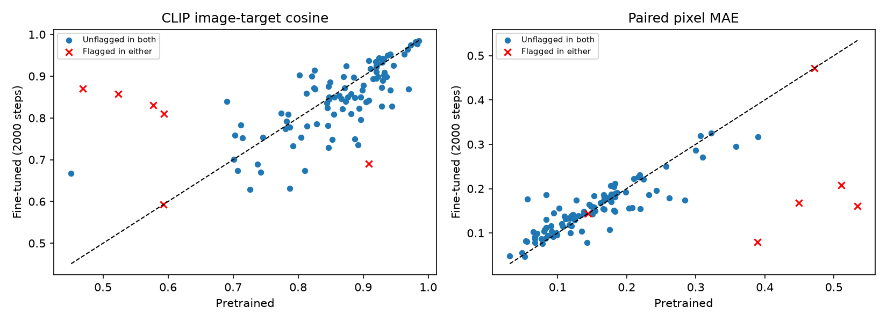
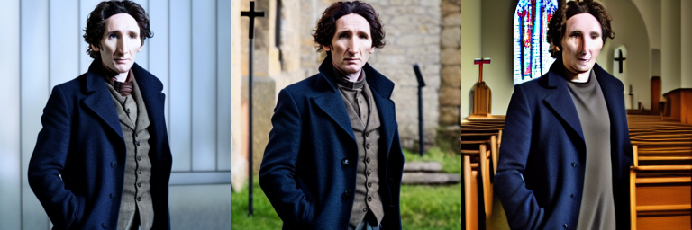
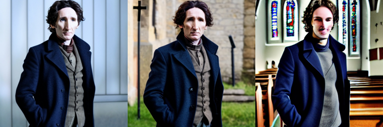
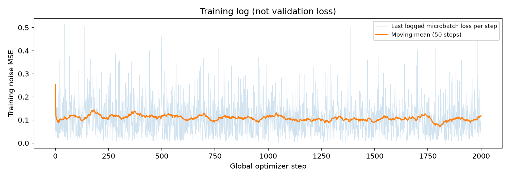

# A2 — Chỉnh sửa ảnh theo chỉ dẫn với InstructPix2Pix

> **Báo cáo kết quả run ip2p_v1, cập nhật 07/11/2026.** Đã xác minh huấn luyện 2.000 steps, validation 20 ảnh và test 100 ảnh. Chưa có đánh giá độc lập bằng con người hoặc tập ảnh ngoài dữ liệu pretrained. Kết quả fine-tune không cải thiện đồng đều so với pretrained.

- Môn học: CO5085 — Học sâu và ứng dụng trong thị giác máy tính, HK261.
- Thành viên: Nguyễn Xuân Trường (2570526), Trần Lê Hoàng Long (2570443).
- Giảng viên: Lê Thành Sách, Nguyễn Quốc Minh.
- Paper: Tim Brooks, Aleksander Holynski, Alexei A. Efros. *InstructPix2Pix: Learning to Follow Image Editing Instructions*, CVPR 2023.
- Trạng thái chủ đề: A2.1 đã nộp DeepLabv3/Pascal VOC; nhóm chuyển sang InstructPix2Pix, chưa có xác nhận giảng viên đồng ý trong dữ liệu hiện có.

## 1. Bài toán và mục tiêu

Đầu vào gồm ảnh nguồn và một câu lệnh chỉnh sửa bằng tiếng Anh. Mô hình sinh ảnh mới phù hợp câu lệnh, đồng thời giữ các nội dung không được yêu cầu thay đổi. Nhóm khảo sát liệu fine-tune một checkpoint đã có trên tập dữ liệu nhỏ có làm thay đổi chất lượng chỉnh sửa so với pretrained hay không.

Hai biến thể so sánh là checkpoint pretrained `timbrooks/instruct-pix2pix` và cùng mô hình sau fine-tune U-Net. Nhóm không huấn luyện từ đầu hoặc tái hiện toàn bộ quy trình xây dựng dữ liệu trong paper.

## 2. Phân tích phương pháp và liên hệ cài đặt

InstructPix2Pix sử dụng latent diffusion, điều kiện hóa bằng ảnh nguồn và câu lệnh. VAE mã hóa ảnh sang latent; U-Net dự đoán nhiễu của latent ảnh đích ở timestep ngẫu nhiên. Ảnh nguồn được mã hóa và ghép với latent nhiễu, vì vậy đầu vào U-Net có 8 kênh. Text encoder cung cấp biểu diễn của lệnh cho cross-attention.

Huấn luyện tối ưu MSE giữa nhiễu dự đoán và nhiễu đã thêm vào latent ảnh đích. Conditioning dropout cho phép sử dụng guidance riêng theo văn bản và ảnh trong suy luận. Script của nhóm giữ nguyên lớp đầu 8 kênh của pretrained InstructPix2Pix; không khởi tạo lại các kênh điều kiện ảnh như khi chuyển từ Stable Diffusion thông thường.

Paper tạo dữ liệu chỉnh ảnh tổng hợp bằng mô hình ngôn ngữ và mô hình tạo ảnh, rồi học từ các bộ ảnh trước/sau và chỉ dẫn. Điểm mạnh là không cần thu thập thủ công lượng lớn cặp ảnh chỉnh sửa. Hạn chế là chất lượng và độ đa dạng của dữ liệu phụ thuộc các mô hình tạo dữ liệu; một lệnh có nhiều đáp án hợp lệ và phép chỉnh lớn có thể làm mất nội dung cần giữ. Paper so sánh định tính với SDEdit/Text2Live, định lượng với SDEdit theo sự nhất quán ảnh và hướng chỉnh sửa trong không gian CLIP; đồng thời khảo sát kích thước/chất lượng dữ liệu tổng hợp. Nhóm chỉ đối chiếu pretrained với fine-tune, không tái hiện các baseline đó; CLIP image-target trong code nhóm khác directional CLIP của paper. [Toàn văn](https://ar5iv.labs.arxiv.org/html/2211.09800).

## 3. Dữ liệu và chia tập

Nguồn dữ liệu: `fusing/instructpix2pix-1000-samples`, gồm 1.000 bộ `input_image`, `edit_prompt`, `edited_image`. Đây là tập chỉ dẫn đa dạng, không phải tập đã lọc chuyên biệt theo thời tiết hay thời điểm trong ngày.

Script nhóm các ảnh nguồn trùng chính xác theo SHA-256 của kích thước và pixel RGB, rồi chia theo nhóm với seed 42. Split thực tế lưu trong manifest:

| Split | Số mẫu | Mục đích |
|---|---:|---|
| Train | 800 | Fine-tune |
| Validation | 100 | Chọn cấu hình/checkpoint |
| Test | 100 | Đánh giá cuối sau khi chốt lựa chọn |

Phép nhóm chỉ phát hiện ảnh trùng chính xác, không đảm bảo phát hiện ảnh gần trùng. Ngoài ra, checkpoint pretrained có thể đã học các mẫu này từ dữ liệu gốc. Vì vậy đây là kiểm tra ảnh hưởng của fine-tune trên split nội bộ, chưa phải bằng chứng tổng quát hóa trên dữ liệu độc lập hoàn toàn.

Ảnh nguồn và đích áp dụng cùng phép resize/crop, đầu vào 256×256; không dùng flip ngẫu nhiên để tránh làm sai lệnh có hướng trái/phải. Phần EDA hiện mới xác minh schema và số lượng split; chưa khảo sát đầy đủ phân bố loại lệnh hoặc nhiễu cặp ảnh.

## 4. Thiết lập thực nghiệm

| Tham số | Giá trị từ file cấu hình |
|---|---|
| Model | timbrooks/instruct-pix2pix |
| Thành phần train | Toàn bộ U-Net; đóng băng VAE và text encoder |
| Độ phân giải | 256×256 |
| Batch / accumulation | 4 / 4; effective batch 16 trên một GPU |
| Precision | BF16 |
| Learning rate | 1e-5, constant, không warmup |
| Optimizer | AdamW theo script train |
| Conditioning dropout | 0,05 |
| Seed train | 42 |
| Ngân sách | Pilot 100 optimizer steps, mục tiêu 2.000 steps |
| Checkpoint | Mỗi 100 steps, giữ hai bản gần nhất |
| Thiết bị | NVIDIA A100-SXM4-40GB, 39,49 GiB khả dụng theo output notebook đã đồng bộ |

Mỗi optimizer step tích lũy 4 microbatch. Với 800 mẫu, batch 4 và một GPU, 100 optimizer steps tương ứng khoảng hai lượt qua tập train; không đồng nhất một optimizer step với một batch ảnh duy nhất.

## 5. Quy trình đánh giá

Hai biến thể dùng cùng ảnh, lệnh, seed 123+i, 20 bước suy luận, text guidance 7,5 và image guidance 1,5. Safety checker được giữ; số ảnh bị đánh dấu được ghi riêng.

- **CLIP image-target cosine:** độ tương đồng ngữ nghĩa giữa ảnh sinh và một ảnh đích tham chiếu; cao hơn là tốt hơn theo proxy này.
- **Paired pixel MAE:** sai số pixel trung bình đã chia 255; thấp hơn là gần ảnh tham chiếu hơn.
- **Thời gian suy luận:** đo theo từng ảnh, có đồng bộ CUDA; bao gồm lần gọi pipeline nhưng không bao gồm tính CLIP/lưu PNG.
- **Đánh giá định tính cần bổ sung:** đúng chỉ dẫn, bảo toàn nội dung và artefact. Chưa có điểm đánh giá con người.

CLIP/MAE không trực tiếp đo tỷ lệ làm đúng lệnh. Một kết quả chỉnh sửa hợp lệ có thể khác ảnh tham chiếu. Không diễn giải hai proxy này thành accuracy và không dùng FID trên tập nhỏ để kết luận chất lượng chỉnh sửa.

## 6. Kết quả pilot đã xác minh

Đánh giá sơ bộ trên 20 ảnh đầu của validation, không phải toàn bộ 100 ảnh:

| Biến thể | CLIP-target ↑ | MAE ↓ | Giây/ảnh | Safety flagged |
|---|---:|---:|---:|---:|
| Pretrained | 0.833348 | 0.156689 | 1.031 | 1/20 |
| Fine-tune 100 steps | 0.845655 | 0.150730 | 0.932 | 1/20 |

CLIP tăng 0.012307; MAE giảm 0.005958. Mẫu nhỏ và có ảnh bị safety checker đánh dấu nên chưa đủ để kết luận cải thiện tổng quát. Không loại bỏ các ảnh đó khỏi bảng một cách âm thầm; cần xem riêng các trường hợp này.

Pilot mất 247,604 giây tổng cộng (4,127 phút); progress log báo khoảng 1,95 giây/optimizer step và step loss cuối 0,164. Step loss là giá trị huấn luyện tại một bước, không phải validation loss hoặc chỉ số chất lượng ảnh. Khác biệt thời gian suy luận giữa hai lượt có thể do warmup/tải hệ thống, không chứng minh fine-tune làm mô hình nhanh hơn.

## 7. Kết quả cuối và thảo luận

### 7.1 Validation và checkpoint được đánh giá

| Biến thể | N | CLIP-target ↑ | MAE ↓ | Safety flagged |
|---|---:|---:|---:|---:|
| Pretrained | 20 | 0,833348 | 0,156689 | 1 |
| Fine-tune 100 steps | 20 | 0,845655 | 0,150730 | 1 |
| Fine-tune 2.000 steps | 20 | 0,858974 | 0,150207 | 1 |

Checkpoint 2.000 có cả hai proxy tốt hơn trên 20 ảnh validation so với các biến thể đã khảo sát và được notebook dùng cho test. Không có bằng chứng đã xem và chấm thủ công toàn bộ validation; chỉ 20/100 ảnh validation được chạy metric. Lựa chọn trên mẫu nhỏ có thể không đại diện cho test. Checkpoint 100 đã được dọn theo chính sách giữ hai bản gần nhất; ảnh và metric pilot được giữ lại.

### 7.2 Test 100 ảnh

| Biến thể | CLIP-target ↑ | MAE ↓ | Giây/ảnh | Safety flagged |
|---|---:|---:|---:|---:|
| Pretrained | 0,847809 | 0,166292 | 0,969 | 5/100 |
| Fine-tune 2.000 steps | 0,843074 | 0,156616 | 0,944 | 2/100 |
| Chênh lệch fine-tuned − pretrained | −0,004735 | −0,009676 | −0,025 | −3 |

Không thể kết luận fine-tune tốt hơn tổng thể: semantic similarity trung bình giảm nhẹ, còn sai số pixel trung bình giảm. Tốc độ gần nhau; phép đo không có nhiều lần lặp nên không kết luận lợi ích tốc độ.

Phân tích paired trên đúng 100 index/câu lệnh chung: CLIP tăng ở 40 ảnh, giảm ở 59 ảnh và không đổi ở một ảnh. MAE giảm ở 37 ảnh, tăng ở 62 ảnh và không đổi ở một ảnh. Việc trung bình MAE giảm dù phần lớn ảnh không giảm cho thấy một số thay đổi lớn ảnh hưởng mạnh tới số trung bình.

Bootstrap paired 10.000 lần, seed 42, cho khoảng percentile 95% của delta CLIP **[−0,021186; 0,013327]**, delta MAE **[−0,024570; 0,003170]**. Cả hai khoảng đều chứa 0; thí nghiệm hiện tại chưa cho bằng chứng rõ về cải thiện trung bình trên tổng thể. Đây là độ bất định do lấy mẫu test, không bao gồm độ biến thiên qua nhiều seed huấn luyện.

### 7.3 Ảnh hưởng của safety checker

Các metric chính giữ nguyên cả ảnh bị safety checker đánh dấu, không loại sau khi thấy kết quả. Pipeline có thể trả ảnh đen cho trường hợp đó; proxy khi ấy phản ánh cả cơ chế kiểm duyệt. Hai biến thể có tập ảnh bị đánh dấu khác nhau.

Phân tích độ nhạy trên **94 ảnh không bị đánh dấu ở cả hai biến thể**:

| Metric | Pretrained | Fine-tuned | Delta |
|---|---:|---:|---:|
| CLIP-target | 0,862938 | 0,847393 | −0,015545 |
| MAE | 0,150321 | 0,153513 | +0,003191 |

Trên tập chung này, cả hai proxy trung bình đều kém đi sau fine-tune. Do đó việc MAE toàn bộ test giảm không nên được trình bày như cải thiện chất lượng chỉnh sửa thuần túy. Phân tích 94 ảnh là kiểm tra độ nhạy sau thực nghiệm, không thay thế bảng 100 ảnh hoặc một benchmark an toàn nội dung.

### 7.4 Ví dụ định tính đã quan sát

Mỗi ảnh dưới đây gồm ba cột **input | target tham chiếu | output**. Chọn cả ví dụ cải thiện proxy lẫn giảm proxy để minh họa, không coi các ví dụ này là mẫu ngẫu nhiên đại diện.

**Index 22 — “make it a church”.** Cả hai output đổi nền sang nội thất nhà thờ. Fine-tuned thay đổi khuôn mặt/biểu cảm và chi tiết trang phục rõ hơn; việc bám câu lệnh không đồng nghĩa bảo toàn danh tính người trong ảnh. Đây cũng là lệnh mơ hồ vì ảnh nguồn có chủ thể là người.

Pretrained:

Fine-tuned:

**Index 60 — “Add a dragon”.** Fine-tuned thêm một con rồng lớn trên bầu trời; target lại có các hình rồng nhỏ ở nhiều vị trí. Đây là trường hợp CLIP-target giảm nhưng output vẫn có thể thỏa ý nghĩa cơ bản của lệnh, cho thấy hạn chế của một ảnh tham chiếu. Cần người chấm thay vì coi điểm giảm là lỗi tuyệt đối.

Pretrained:

Fine-tuned:

**Index 51 — “make it a Parisian clocktower”.** Fine-tuned giữ bố cục poster và chủ thể người nhiều hơn pretrained; pretrained biến phần lớn poster thành cảnh tháp. Tuy vậy, cả hai vẫn gặp chữ bị biến dạng và hình tháp không đủ rõ để kết luận chắc chắn đã thực hiện đúng yếu tố “clocktower”. CLIP-target cao hơn không đủ xác nhận thành công đầy đủ.

Pretrained:

Fine-tuned:

### 7.5 Loss, thời gian và chi phí

Pilot 100 steps mất **247,604 giây**; lượt resume 100 → 2.000 mất **3.313,318 giây** (55,222 phút). Tổng hai lần gọi train là **3.560,922 giây**, khoảng **59,35 phút**; không bao gồm setup, tải dữ liệu, các lần compare hoặc demo. Lượt resume gồm khởi tạo, lưu checkpoint và export pipeline cuối. Loss bước cuối 0,166 vẫn là training loss của một microbatch; không so trực tiếp với loss pilot để kết luận chất lượng.

Đường cong lấy giá trị microbatch được ghi cuối cùng tại mỗi optimizer step từ progress log, đường trơn là trung bình trượt 50 steps; không phải epoch loss hay validation loss. Fine-tune 2.000 steps với effective batch 16 và 800 ảnh tương đương khoảng 40 lượt qua train, có nguy cơ overfit tập nhỏ.

Checkpoint cuối có khoảng **3,44 GB trọng số U-Net** và **6,88 GB optimizer**, chưa tính thành phần nhỏ khác. Việc lưu checkpoint toàn bộ thường xuyên trên Drive có chi phí I/O và dung lượng đáng kể.

### 7.6 Kết luận trong phạm vi thực nghiệm

Nhóm đã triển khai và chạy thành công pipeline chỉnh sửa ảnh theo chỉ dẫn với hai biến thể pretrained/fine-tuned. Fine-tune cải thiện proxy trên validation nhỏ nhưng chưa chuyển thành cải thiện đồng đều trên test. Khi xem xét ảnh bị safety checker đánh dấu và những trường hợp có nhiều đáp án hợp lệ, dữ liệu hiện tại không đủ để tuyên bố fine-tune làm mô hình tốt hơn. Hướng tiếp theo là tăng tính đại diện của validation, dùng bộ ảnh/chỉ dẫn ngoài dữ liệu pretrained, chấm người theo rubric và chạy thêm seed; không tiếp tục chọn hyperparameter bằng tập test đã xem.

## 8. Tái lập và sản phẩm

- Notebook: [A2_Colab_InstructPix2Pix.ipynb](A2_Colab_InstructPix2Pix.ipynb).
- Source: [instructpix2pix/](instructpix2pix/).
- Cấu hình/split: `runs/ip2p_v1/experiment.json`, `split_manifest.json`.
- Bản sao cấu hình, thời gian, năm bộ summary/CSV và phân tích paired được lưu tại [report_assets/](report_assets/) để có thể đưa vào Git mà không kèm checkpoint. `paired_analysis.json` dùng 10.000 bootstrap resamples, seed 42; `training_loss.csv` lưu loss đã trích từ log.
- Notebook lưu checkpoint và log trên Drive; đọc ảnh/cache trên ổ cục bộ Colab. Resume không cam kết bit-for-bit.
- Đã có ảnh demo `runs/ip2p_v1/demo.png`; chưa có video demo hoặc báo cáo PDF. Các ảnh minh họa trong báo cáo lấy từ test, không dùng ảnh demo chưa được kiểm tra để khẳng định chất lượng.

## 9. Hỗ trợ AI

OpenAI Codex hỗ trợ triển khai, rà soát code, đọc các file kết quả đã đồng bộ và soạn báo cáo. Nhóm chịu trách nhiệm xác minh dữ liệu, kết quả, nguồn tham khảo và nội dung nộp. Số liệu trong phần pilot được đọc từ các file JSON/log của lần chạy, không lấy từ smoke test tổng hợp.

## Tài liệu tham khảo

1. Brooks, Holynski, Efros. *InstructPix2Pix: Learning to Follow Image Editing Instructions*, CVPR 2023. [Paper](https://arxiv.org/abs/2211.09800).
2. [Code và dữ liệu tác giả](https://github.com/timothybrooks/instruct-pix2pix).
3. [Diffusers training example v0.35.1](https://github.com/huggingface/diffusers/blob/v0.35.1/examples/instruct_pix2pix/train_instruct_pix2pix.py). Source nhóm sửa từ script này, giữ Apache-2.0.
4. [Tập 1.000 mẫu](https://huggingface.co/datasets/fusing/instructpix2pix-1000-samples).
